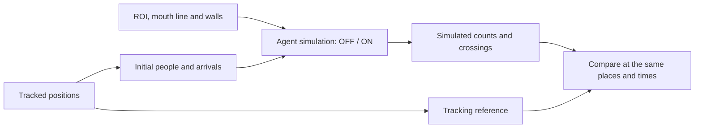

# Stadium egress simulation

Simulate people moving through stadium tunnel areas, using tracked video to supply the initial crowd and later arrivals.

Code for **Video-Driven Agent-Based Simulation of Stadium Egress**, by Ao He and Vivian W. H. Wong. [中文说明](README_zh.md)

## What the model does

We study how crowds build up and clear near a tunnel mouth during stadium egress, the process of leaving the stadium after an event. Each simulated person is an **agent** with a position, route and desired walking speed. The model advances their movement in small time steps while accounting for nearby people and walls.

The experiment tests **congestion feedback**. Agents contribute to a grid that measures local crowding. Where crowding exceeds a fixed threshold, the grid sends a bounded correction back to their movement. We compare feedback **OFF** and **ON** with the same people, arrivals and random seed.

The stadium experiment covers six tunnels, A–F, over the full recording. Each tunnel is simulated separately inside its camera's **observation region (ROI)**. The included data are already processed; you can run the simulations without downloading the videos or running a detector.



The reference counts are measured from the tracks. They are used to evaluate the result; they do not reset the simulated crowd to match the video.

## Three experiments

| Experiment | What it answers | What is included |
|---|---|---|
| Stadium | How does feedback affect agreement with tracked occupancy and tunnel crossings? | Six tunnel recordings, ten paired seeds, 120 runs |
| S1 bottleneck | What does feedback change when geometry and inflow are controlled? | A plaza, narrow tunnel and timed gate; four inflows, 80 runs |
| MOT20 auxiliary check | How well do short simulated trajectories match annotated pedestrian tracks? | Four valid windows, four motion methods; [details](auxiliary/mot20/README.md) |

S1 is the small experiment to run first. “Paired” means each seed is used once with feedback OFF and once with feedback ON.

## Start here

Use Python 3.11+ and Node.js 20+. The recorded simulations used Node.js 24.19.0. Python manages runs and analysis; Node executes the movement model. The simulation uses CPU workers and does not use a GPU.

Download the repository using **Code → Download ZIP** and extract it, or clone it:

```bash
git clone https://github.com/ahe619/Flow-Simulator.git
cd Flow-Simulator
```

Open a terminal in the directory containing `run.py` and `README.md`. Install the Python dependencies and check Node:

```bash
python -m pip install -r requirements.txt
node --version
python verify_package.py
```

No npm packages are required. For environment setup and Windows instructions, use the [first-run guide](docs/getting-started.md).

## Run a small example

These commands run one S1 seed with feedback OFF and ON, calculate the metrics, and produce a figure:

```bash
python run.py bottleneck --inflows 6 --seeds 1 --output outputs/s1_demo
python evaluate.py --experiment bottleneck --runs outputs/s1_demo --output outputs/s1_demo_eval
python render.py --evaluation outputs/s1_demo_eval --output outputs/s1_demo_figures
```

Open `outputs/s1_demo_figures/bottleneck_metrics.png`. It shows completion time, peak crowding before the gate and peak exit flow. The underlying numbers are in `outputs/s1_demo_eval/figure_data/`. A single seed demonstrates the workflow; the paper's paired confidence intervals require ten seeds.

Output directories must be new. If you already ran this example, choose new names or follow the [resume instructions](docs/reproduction.md#resume-an-interrupted-batch).

The [first-run guide](docs/getting-started.md) explains the files produced at each step. `quickstart.ipynb` provides the same S1 workflow in a notebook.

## Run the stadium experiment

Start with tunnel E and one paired seed:

```bash
python run.py stadium --tunnels E --seeds 1 --output outputs/e_demo
python evaluate.py --runs outputs/e_demo --data data/stadium --output outputs/e_demo_eval
python render.py --evaluation outputs/e_demo_eval --output outputs/e_demo_figures --animate
```

This runs the complete recording for E. The animation displays saved ROI counts and the event timeline. Native agent positions are also saved in the run JSON; the portable renderer does not generate the manuscript's spatial agent animations.

To reproduce all six tunnels and ten paired seeds:

```bash
python run.py stadium --full --workers 22 --output outputs/stadium_full
python evaluate.py --runs outputs/stadium_full --data data/stadium --output outputs/stadium_eval
python render.py --evaluation outputs/stadium_eval --output outputs/stadium_figures --animate
```

The launcher may lower the worker count to fit available memory. The archived batch took 20.2 min on 22 CPU workers, with one completed benchmark reused. Runtime will vary on another machine. The saved runs occupy about 3.3 GB; allow at least 6 GB for runs and analysis outputs.

## What the results show

In S1 at high inflow, feedback reduces the peak count before the gate but extends clearance time. The stadium effect depends on the tunnel: ROI occupancy error falls in B, D and E, rises in A and C, and has a paired interval spanning zero in F.

The model also retains too many people in some ROIs. Desired speeds estimated from slow observed movement and incomplete arrival inputs help explain the mismatch. Read [the results guide](docs/results.md) for the numbers, how to interpret RMSE and the shaded bands, and what the comparison supports.

## Find the right file

| Location | Purpose |
|---|---|
| `run.py` | Run, resume and verify experiments |
| `evaluate.py` / `render.py` | Turn saved runs into tables, figures and count animations |
| `prepare.py` | Rebuild stadium inputs from the original tracking CSV |
| `phase_timing.py` | Calculate crowd-rise and decline times from saved total counts |
| `src/engine/` | The four numerical engines |
| `src/inputs/` | Project tracks onto the floor and construct arrivals and speed histories |
| `data/` | Prepared stadium inputs, tracking reference and geometry |
| `configs/` | The S1 protocol |
| `reference/` | Archived tables for checking a reproduction |
| `auxiliary/mot20/` | The separate annotated-trajectory check |
| `tests/` | Checks for motion, input preparation, statistics and rendering |

The historical filename `stadium-macro-engine.js` contains the **agent-based** stadium model. The four engine files retain the bytes used in the recorded experiments.

## Read further

- [First-run guide](docs/getting-started.md): setup, a complete small example and common errors.
- [Model and measurements](docs/method.md): feedback, geometry, arrivals, units and time.
- [Reading the results](docs/results.md): outputs, error metrics and expected findings.
- [Reproduce the study](docs/reproduction.md): full commands, resume, tests and input reconstruction.
- [Data format](docs/data_format.md): file contents and field definitions.
- [Provenance](docs/provenance.md): code and data origins, AI assistance and distribution scope.

The package includes processed numeric inputs and reference tables. Raw videos, the original detector/tracker execution, paper drafts and manually composed figure panels remain outside this repository. No software or data license has been assigned in this package.
