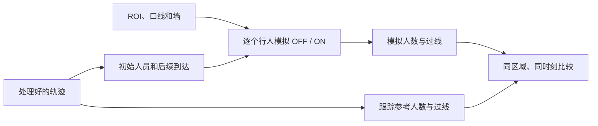

# 体育场散场模拟

用视频中的行人轨迹提供初始人群和后续到达，让模拟器计算这些人怎样经过通道口、形成聚集，再逐渐离开。

这是 Ao He 和 Vivian W. H. Wong 的论文 **Video-Driven Agent-Based Simulation of Stadium Egress** 对应的代码。[English README](README.md)

## 我们在研究什么

散场时，同一个场馆的不同通道可能出现不同情况：有的通道已经开始变空，有的口前还聚集着很多人。我们希望在整段录像中模拟这种变化，再和视频里跟踪到的人数、过线人数对比。

模拟器采用微观的 **agent-based model**。一个 agent 就代表一个模拟行人，有自己的位置、路线和期望速度。程序逐步计算每个人的运动，并处理人与人、人与墙之间的约束。

这里重点检查的是**拥堵反馈（congestion feedback）**：把行人的位置汇总到网格上，估计局部拥挤程度；超过阈值时，再把一个有上限的速度修正反馈给行人。每组实验使用相同的人流输入和随机种子，分别运行反馈关闭（OFF）和开启（ON），比较两者的结果。

## 先理解这几个词

| 名称 | 在这个项目中的含义 |
|---|---|
| ROI | 相机画面中选定的地面观测区域。人数统计和模拟比较都在这个范围内进行 |
| Occupancy | 某一时刻 ROI 里面有多少人 |
| Mouth line | 通道口的过线计数线 |
| Egress count | 从广场侧进入通道，累计穿过口线的人数 |
| Egress flow | 每 10 s 从广场侧穿过口线的人数 |
| Desired speed | agent 在运动规则中采用的期望速度；本实验根据已有轨迹估计 |
| Seed | 控制随机抽样的编号。同一个 seed 的 OFF/ON 使用相同抽样 |
| RMSE | 衡量模拟人数与参考人数差距的指标，越小表示该指标上的误差越小 |

六个通道 A–F 分别运行。我们比较的是每个相机 ROI 内的情况，不是把整个体育场的每一个人都放进同一个模型，也没有跨相机追踪同一个人的完整行程。

## 数据怎样进入模拟



观测到的总人数和离场人数用于评价。程序不会为了贴近这些曲线，定时把模拟人数改回观测值。我们已经把六通道的输入准备好，第一次运行不需要原视频，也不需要重新做目标检测。

## 三部分实验分别做什么

| 实验 | 场景 | 用途 |
|---|---|---|
| Stadium 主实验 | A–F 六个真实通道，各自覆盖整段录像 | 看模拟的人数变化和过线情况能否接近自动跟踪参考 |
| S1 瓶颈实验 | 两侧来人进入广场，再经过带闸门的窄通道 | 在输入已知的条件下，看反馈怎样改变聚集和排空 |
| MOT20 辅助检查 | 四个带人工轨迹标注的有效窗口 | 检查短时间内的个体轨迹误差 |

S1 的 “S1” 是实验编号。它的闸门在第 18 个模型秒打开，到达在第 24 个模型秒结束。先跑 S1，最容易确认程序是否能正常工作。

`auxiliary` 文件夹存放 MOT20 辅助实验。Stadium 主实验不依赖它运行，保留它是为了让读者也能复现论文里的短时轨迹检查。

## 第一次运行

需要 Python 3.11 以上和 Node.js 20 以上。参考实验使用 Node.js 24.19.0。Python 负责调度和分析，Node.js 执行运动模型。模拟使用 CPU，不调用 GPU。

在 GitHub 点 **Code → Download ZIP**，解压后进入包含 `run.py` 和 `README.md` 的目录。在 Windows 文件资源管理器的地址栏输入 `powershell` 并回车，就能在这里打开终端。

先检查环境，再安装 Python 依赖：

```bash
python --version
node --version
python -m pip install -r requirements.txt
python verify_package.py
```

然后逐条执行：

```bash
python run.py bottleneck --inflows 6 --seeds 1 --output outputs/s1_demo
python evaluate.py --experiment bottleneck --runs outputs/s1_demo --output outputs/s1_demo_eval
python render.py --evaluation outputs/s1_demo_eval --output outputs/s1_demo_figures
```

三条命令分别是：运行模拟、计算指标、画图。第一条会运行同一个 seed 的 OFF 和 ON，共两次。最后打开 `outputs/s1_demo_figures/bottleneck_metrics.png`，就能看到完成时间、闸门前峰值人数和峰值出流。

`outputs/s1_demo_eval/figure_data/` 保存图里的数值。一个 seed 用于确认流程；论文中的均值和配对区间来自十个 seed。

如果更习惯 notebook，先安装 `requirements-notebook.txt`，再用 JupyterLab 或现有编辑器打开 `quickstart.ipynb`。更完整的步骤和常见报错见[首次运行指南](docs/getting-started.md)。

## 从一个通道开始

下面运行 E 通道整段录像的一组 OFF/ON：

```bash
python run.py stadium --tunnels E --seeds 1 --output outputs/e_demo
python evaluate.py --runs outputs/e_demo --data data/stadium --output outputs/e_demo_eval
python render.py --evaluation outputs/e_demo_eval --output outputs/e_demo_figures --animate
```

生成的动画显示 ROI 人数色块和整场时间轴；它不是原视频，也不是小人运动的空间动画。小人的位置保存在运行 JSON 中，可以用于进一步绘图。现有渲染入口负责时序图、快照和人数总览动画。

## 复现完整六通道实验

```bash
python run.py stadium --full --workers 22 --output outputs/stadium_full
python evaluate.py --runs outputs/stadium_full --data data/stadium --output outputs/stadium_eval
python render.py --evaluation outputs/stadium_eval --output outputs/stadium_figures --animate
```

`--full` 表示六个通道、十个 seed、开关两种条件，共 120 次运行。`--workers 22` 是最多同时运行 22 个进程；普通电脑可以改成 `--workers 4`，种子决定的模拟结果不受并行数影响。程序会根据可用内存继续下调并行数。

原实验批处理记录为 20.2 分钟，使用 22 个 CPU 进程，并复用了一个已经完成的 benchmark。别的机器耗时会不同。完整运行文件约 3.3 GB，建议至少预留 6 GB 给运行和分析输出。

每个输出目录都应使用新名字。续跑时重复原来的运行命令并加 `--resume`；程序会核验已完成文件再继续。更改输入、数值代码、任务集合或诊断时长时，需要换输出目录。

## 怎样看结果

先看人数曲线，再看 RMSE 和过线误差。模拟人数更接近参考，并不一定意味着离场人数也更接近，两者要分别检查。

整场实验中，反馈降低了 B、D、E 的 ROI 人数误差，增加了 A、C 的误差，F 的配对区间包含零。S1 在高入流时呈现另一个变化：闸门前峰值人数降低，但排空更慢。这些结果保存在 `reference/`，不会在复现时按结果调参。

曲线外的阴影表示不同 seed 的最小值到最大值，不是 95% 置信区间。Stadium 的参考来自自动跟踪；MOT20 使用人工标注，但它的短时检查不能代替 Stadium 的真实人数验证。

单位 `W` 是各通道口的宽度。例如 `0.1 W/s` 表示每秒走该通道口宽度的十分之一。我们没有把它直接当成米。S1 使用独立的参考长度 `W0`，MOT20 使用 `U`，这三个尺度不能混用。

## 文件在哪里

| 文件或目录 | 用途 |
|---|---|
| `run.py` | 运行、续跑和核验 |
| `evaluate.py` | 计算误差、配对差值、阶段指标和输入覆盖率 |
| `render.py` | 根据结果表画图和生成人数总览动画 |
| `prepare.py` | 从原始跟踪 CSV 重建这次研究的输入 |
| `data/` | 已准备好的输入、参考观测和几何 |
| `src/` | 运动引擎和数据处理模块 |
| `reference/` | 用于核对复现结果的已有表格 |
| `tests/` | 数值、输入、统计和绘图检查 |
| `auxiliary/mot20/` | MOT20 辅助实验 |

`stadium-macro-engine.js` 是沿用的文件名，内容仍然是逐个行人运动的微观模型。

继续阅读：[模型解释](docs/method.md)、[结果解读](docs/results.md)、[完整复现步骤](docs/reproduction.md)、[数据格式](docs/data_format.md)、[来源说明](docs/provenance.md)。

这个仓库包含模拟复现需要的处理后数据和代码。原始视频、原始检测跟踪的执行流程、论文排版和手工拼图素材没有打包。
