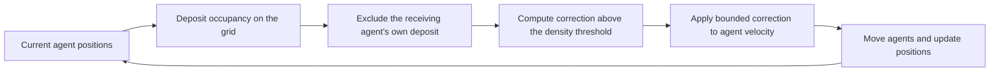

# Model and measurements

The model calculates individual pedestrian movement inside each tunnel's visible floor region. Tracked positions supply the starting crowd, arrival times and speed histories. The experiment then compares movement with congestion feedback OFF and ON.

For commands, use the [first-run guide](getting-started.md). For the numerical findings, read [the results guide](results.md).

## A person in the model

An agent has a position, velocity, desired speed and a sequence of route waypoints. It moves toward its next waypoint, adjusts its velocity over time, responds to nearby people and stays outside physical walls. When it leaves the observation domain, the simulator removes it from that local population.

Desired speed is an input to the motion rule, not a guarantee of the speed seen in the output. Walls, other people, route changes and congestion feedback can alter actual movement.

With feedback OFF, individual motion, pairwise repulsion and wall constraints remain active. ON adds the grid-based correction. This pairing tests the additional effect of that correction.

## The feedback loop



The grid divides the floor into small cells. Quadratic B-spline weights spread each agent's contribution across nearby cells. Accessible cell area accounts for walls and cut cells, and visibility checks prevent feedback through a wall.

For each receiving agent, the field excludes that agent's own contribution before calculating the congestion coefficient. Below the density threshold, its congestion correction is zero. Above the threshold, the grid applies a correction based on the spatial weights and neighboring occupancy. An isolated agent therefore receives exactly zero congestion feedback.

The correction has a maximum acceleration and an individual speed limit. It may change how the crowd spreads or how long it stays near the mouth; its effect is measured in the output.

The implementation is in [pressure-field.js](../src/engine/pressure-field.js), with the agent update in [stadium-macro-engine.js](../src/engine/stadium-macro-engine.js).

## The stadium geometry

Each tunnel has an annotated ROI, a mouth line, physical wall segments and routes. The ROI is the observed floor area used for counting and comparison. A physical wall blocks motion; an open observation boundary allows a person to enter or leave the local model.

The ROI follows visible floor and the supplied geometry. Its area differs between tunnels. A, B, C, D, E and F are independent local simulations, so a sum of ROI counts is not a count of unique attendance across the stadium.

Coordinates are normalized by each tunnel's mouth width, `W`. A distance of `0.5 W` is half that tunnel's mouth width. A speed of `0.1 W/s` is one tenth of that width per source-video second. Without a measured physical length, these values do not imply metres or metres per second.

D uses a one-time registration of its annotation to the calibration reference, followed by fixed geometry throughout the recording. Subsequent camera movement is uncorrected.

## Initial people and arrivals

People visible inside the ROI at the first tracked sample become initial agents. Later boundary arrivals require an outside-to-inside segment and two consecutive inside samples. This confirmation reduces arrivals caused by a single noisy boundary sample.

A new track first visible inside the tunnel strip can enter from its deep boundary as an outbound arrival. Other tracks first detected in the interior do not supply boundary demand. Each source identity contributes at most once to the prepared demand.

An arrival is assigned a sampling bracket, rather than an exact observed arrival instant. The seed chooses a time within that bracket. If space at the entry is unavailable, the person remains pending until admitted. Pending people belong to the demand record but do not count as people already inside the ROI.

Recorded boundary arrivals supply demand throughout the run. The simulator is conditioned on those arrivals; it does not forecast when the event will end or how many new people will approach a tunnel.

## Desired speeds and seeds

When a person has usable history, the input speed comes from their last consecutive displacement, with a floor of `0.03 W/s`. Otherwise, an arriving person draws a speed from eligible observations in the preceding 60 s, ending no later than the start of their arrival bracket. An empty pool uses the same floor. Initial people without history also use the floor.

Seeds determine the speed draws, arrival times within brackets and the grid origin within one cell. Matching OFF and ON seeds share these choices. Variation between them therefore isolates the feedback condition within the supplied input rules.

A slow observed displacement may come from waiting or queueing. If the model retains it as a person's desired speed, that person can remain slow after the local crowd changes. This input choice matters when interpreting occupancy and clearance.

## Fixed stadium parameters

| Setting | Value or rule |
|---|---|
| Body radius | `0.07 W` |
| Maximum integration substep | `0.02` source-video s |
| Grid spacing | `0.28 W` |
| Feedback gain | `0.3 W²/s²` |
| Feedback acceleration limit | `0.8 W/s²` |
| Individual speed limit | `1.55 ×` the person's desired speed |
| Density threshold | One calibration from the recording's first 60 s, then fixed |

The threshold is the larger of the occupancy-weighted 75th percentile of observed grid density and the weighted 99th percentile of isolated-agent density. The first-minute calibration overlaps the start of the evaluated recording. It is a retrospective calibration, not a claim that the opening minute was known before recording began.

The complete parameters and calibration records are in [the prepared inputs](../data/stadium/calibrated_inputs/) and [protocols](../data/stadium/protocols/). Reproduction uses those saved values.

## What we measure

| Quantity | Definition |
|---|---|
| ROI occupancy | Number of people inside the observation region |
| Mouth-front occupancy | Number in the area extending `1 W` toward the plaza and `1 W` across, intersected with visible floor |
| Egress count | Cumulative plaza-to-tunnel crossings of the finite mouth line |
| Egress flow | Plaza-to-tunnel crossings in each 10 s bin |
| Reverse flow | Crossings in the opposite direction, retained separately |
| Feedback activation | Fraction of agent-substeps receiving a nonzero congestion correction |

At `t = 0, 10, 20, ...` source-video seconds, simulated counts are sampled exactly. Reference counts use the nearest preceding native tracking sample. The output records that sample's actual time and lag.

A strict reference crossing requires the same identity in consecutive native samples, valid projected positions, at least one endpoint inside the ROI, and a segment intersecting the annotated mouth line in the required direction. Crossing-error bins that touch missing intervals are excluded. Cumulative strict counts retain the events that were actually observed.

Local density and speed samples are also saved. Both reference and simulation use the same Gaussian density estimator with `σ = 0.25 W` and a cutoff of three standard deviations. Speed uses consecutive native positions divided by their actual time interval. This measurement estimator is separate from the grid used to apply feedback.

## Two time coordinates

Source-video time measures elapsed seconds since the first tracked sample. Dataset time `tV` advances by one for each native sample interval. The intervals are `1 s` for A and `29/29.97 s` for B–F.

Figures use dataset time so tunnels share the event-phase labels. Numerical integration and 10 s measurement bins use source-video seconds. The protocol records this conversion. Event phases group measurements and provide timeline labels; they do not switch the movement rules.

## The S1 bottleneck

S1 supplies known demand to a controlled geometry. Two streams enter a plaza and approach a narrow tunnel. A gate inside the tunnel initially blocks passage, so agents accumulate upstream. Opening it allows the crowd to drain toward the outlet.

```text
      inflow →        PLAZA        ← inflow
      ──────────────┐      ┌──────────────
                    │      │  mouth
                    ├──────┤  gate inside tunnel
                    │      │
                    └  ↓   ┘  outlet
```

This is a schematic of the arrangement. The tunnel width is `0.6 W0`; `W0` is a synthetic reference length, separate from stadium `W`. The gate opens at 18 model s and arrivals end at 24 model s.

The study uses inflows of 1, 2, 4 and 6 agents/model s, ten paired seeds each, and `dt = 0.01` model s. Completion time ends when inflow has stopped and both active and pending populations are empty. The primary crowding metric counts people before the gate. The separate mouth-front count refers to the plaza-side area; the two regions can respond differently.

[S1 configuration](../configs/bottleneck.json) defines the geometry, threshold, regions and demand hashes. The [results guide](results.md#controlled-bottleneck) explains the observed trade-off between crowding and clearance.
